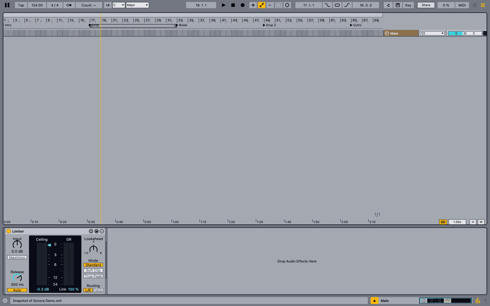
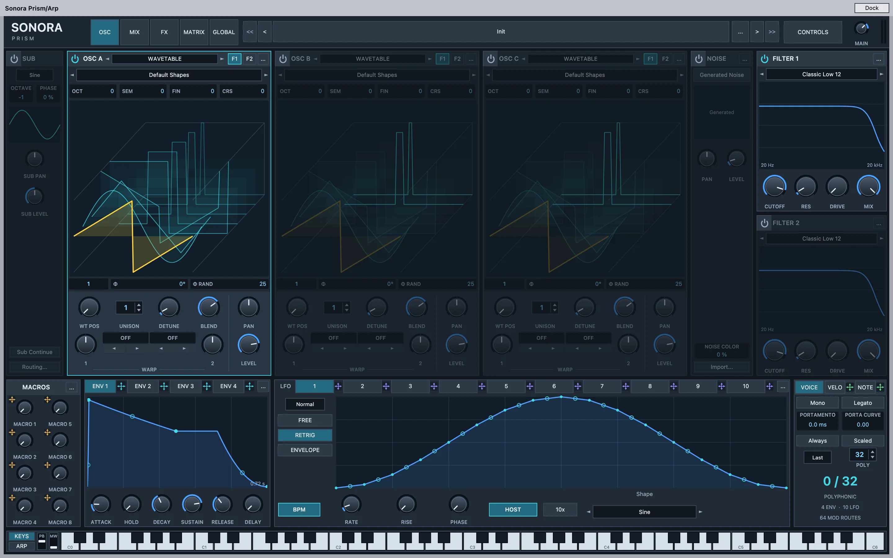

# Sonora

<p align="center">
  <a href="https://sonoradaw.com"></a>
</p>

<p align="center">
  <a href="https://sonoradaw.com/download.html"><b>Download</b></a> ·
  <a href="https://sonoradaw.com">Website</a> ·
  <a href="docs/ROADMAP.md">Features</a> ·
  <a href="https://ko-fi.com/lordillusions">☕ Buy me a coffee</a>
</p>

**Sonora DAW** is a free, open-source digital audio workstation for macOS, written from scratch. Its layout follows
the workflow many producers already know, so you can start making music without learning a new program. It is built
for starting new tracks, especially electronic music, and it can also open and save Ableton Live 12 sets.

> **Alpha.** Sonora is very early software and will have bugs. Keep backups of your work, and please report what
> breaks: the idea is to build it together with the people who use it.

- Website: <https://sonoradaw.com>
- Downloads: [Releases](https://github.com/lordillusions/sonora/releases)
- Everything it does today: [docs/ROADMAP.md](docs/ROADMAP.md)
- User guide: [docs/UI_GUIDE.md](docs/UI_GUIDE.md)

## Highlights

- Arrangement and Session views, MIDI and audio editing, warping, automation, racks, groups and returns.
- Built-in instruments, including **Sonora Prism** (also available as a VST3 plug-in for other hosts) and
  **Sonora Resynth**.
- VST3 and Audio Unit plug-ins, MIDI controllers and MIDI learn.
- Real-time collaboration over the internet or the local network.
- A built-in assistant, and an MCP server so external agents can work on the open project, every change undoable.
- Updates delivered as small delta patches.

<p align="center"></p>

## Support

Sonora is free and stays free. Hosting, collaboration servers, AI tools and a lot of evenings go into it; if it helps
you make music, you can [buy me a coffee on Ko-fi](https://ko-fi.com/lordillusions). Monthly supporters can have their
name in Sonora's About window and on [sonoradaw.com](https://sonoradaw.com/about.html#supporters).

## Build from source

macOS 13 or later on Apple silicon, Xcode command-line tools, CMake and Ninja.

```bash
scripts/bootstrap.sh                                   # fetches JUCE and Skia
cmake -S . -B build -G Ninja -DCMAKE_BUILD_TYPE=Debug
cmake --build build
./build/tests/sonora_tests
open build/src/Sonora_artefacts/Debug/Sonora.app
```

The Sonora Prism VST3 plug-in: `cmake --build build --target SonoraPrism_VST3`. Linux and Windows builds:
[docs/PLATFORMS.md](docs/PLATFORMS.md). Installers: [docs/INSTALLERS.md](docs/INSTALLERS.md). How the code is
organised: [docs/ARCHITECTURE.md](docs/ARCHITECTURE.md).

## Contributing

Bug reports, feature requests and pull requests are welcome through GitHub Issues and Discussions. Please include
your macOS version, what you did, and a small set that shows the problem when you can.

## License and trademarks

Sonora is licensed under the GNU Affero General Public License v3.0 or later (see [LICENSE](LICENSE)); it is built
with JUCE under its AGPL option.

Ableton and Live are trademarks of Ableton AG. Sonora is an independent project, not affiliated with or endorsed
by Ableton. Sonora contains no Ableton code or content; it reads and writes
sets through their file format.
