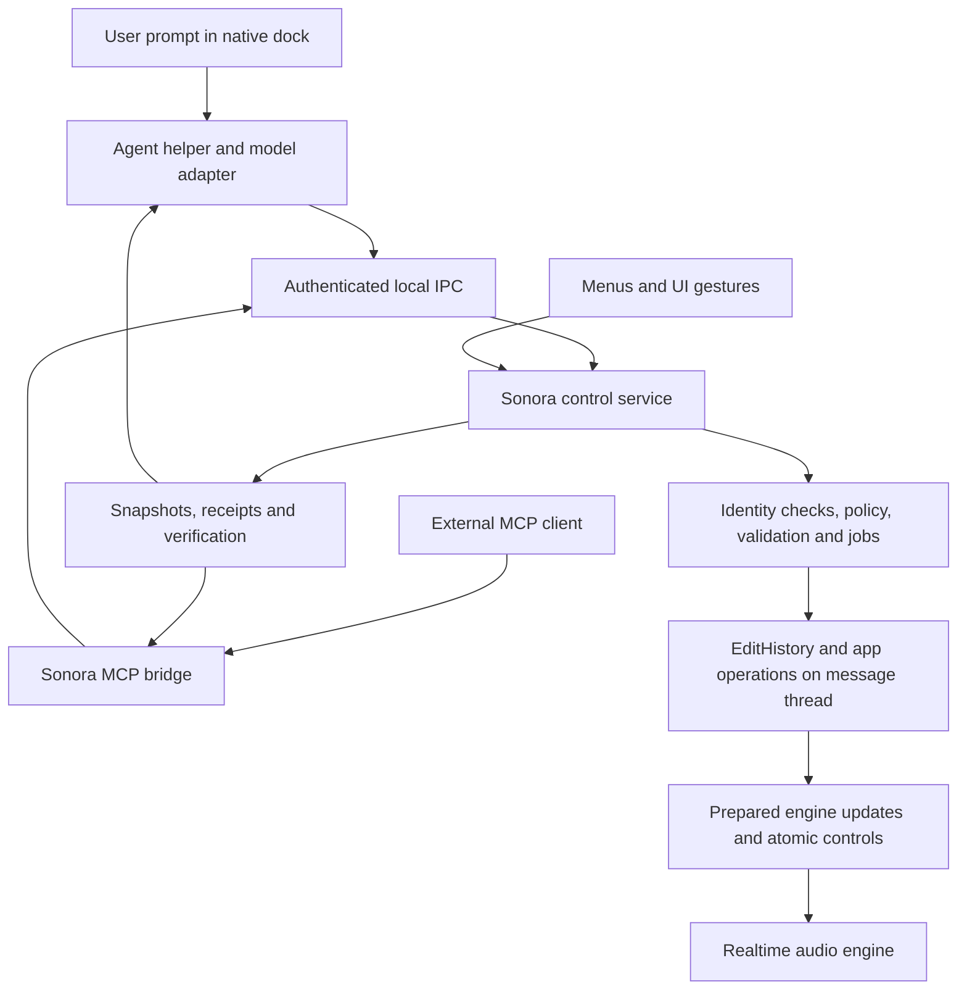

# Sonora native assistant and MCP implementation plan

Status: proposed design, 2026-10-15. Roadmap: AGT-0–AGT-9 and MCP-1–MCP-3.

Implementation checkpoint (2026-10-16): the shared API, Agent Control and local MCP bridge exist. External MCP remains
the default: its panel shows access/activity/results/undo, with prompts entered in the external client. Optional
native provider/key configuration now reveals an LLM composer. AGT-6a implements Responses,
compatible Chat and Anthropic framing, Keychain credentials and a bounded worker directly over the shared API. It uses
Apple networking rather than the proposed bundled TypeScript helper; isolation and live-model qualification remain open.
See [native LLM setup](agent/NATIVE_LLM.md). The implemented
contract and setup are in [docs/agent](agent/README.md). General MIDI add/update/delete/replace now cover Arrangement,
Session and takes, and generic top-level VST3 parameter batches capture live undo state and verify isolated state reload
before replacing the processor. AGT-7c (2026-10-17) extends this to registered native/rack parameters, a catalogue of
implemented native/scanned VST3 devices, ordered insertion on existing tracks and captured-live removal. Native
parameters accept processor units or explicit linear normalization; the same tools serve MCP and native LLMs.
Serum 2 and Vital have disposable save/reload acceptance probes. The sections below retain the broader design and future release
criteria; they do not imply full application coverage has shipped.

Build a typed Sonora control service first, use it from a native assistant panel, and later expose the same service through MCP. The app owns validation, permissions, state changes and verification. The model interprets requests, chooses supported operations and explains results. The audio engine keeps its existing realtime boundaries.

The product goal is complete coverage of supported Sonora workflows: inspect, compose, edit, arrange, mix, automate, record, render and manage projects. “Everything asked” cannot mean arbitrary execution or capabilities Sonora does not have. A published capability matrix must distinguish implemented, partially supported, unavailable and temporarily blocked operations. An agent must explain a limitation instead of reporting a successful approximation. Musical judgments also need an audition path; a successful parameter write alone does not establish a better mix.

## 1 Current foundations and gaps

| Area | Existing implementation | Work needed for reliable agents |
| --- | --- | --- |
| Commands and history | `src/core/Edit.*`: `EditCommand`, `EditHistory`, `compose`; `AppController::applyEdit` refreshes model, engine and UI | Typed requests/results, query API, preconditions, preview and transaction receipts. `applyEdit` currently returns `void` and can reject through status text or silently; agents need explicit outcomes. |
| Object identity | Track IDs, clip UIDs, explicit Arrangement/Session/take `ClipLocation`, device IDs, saved clip location mapping | Document-scoped public handles; stable scene and nested rack-chain identity; resolve indices only immediately before execution. Clip UIDs are runtime identities, not permanent references across reloads. |
| Live controls | Transport, mixer and device atomics; UI/MIDI write several controls directly | Unified write semantics, before/after values, dirty state, history, automation override rules and revision tracking. Reading `Song` alone misses live values. |
| Async work | Parsing, sample loading, scanning, recording drain, export and stem jobs | Consistent job IDs, progress, cancellation, completion, stale-document checks and operation conflicts. |
| Export | `AppExport.cpp`, `engine/Exporter`, `beginOffline`/`endOffline` | Separate destination selection from execution; enforce graph exclusion in the service. Current protection relies partly on a modal UI/menu guards. |
| Audio analysis | `MasterMonitor`, loudness, spectrum and stereo analysis | Structured reports with source, time window, completeness and render revision; track analysis needs additional work. |
| UI | Custom Skia widgets, JUCE window, Metal native view | Assistant panel, real text composition and accessibility. UI_GUIDE and ADR 0004 currently prefer no native widgets in the main window. |
| App targeting | `Main.cpp` permits one instance and owns one controller/window | Explicit launch/document identities and authenticated attachment even with one instance; multi-instance support is separate future work. |
| Coverage | Rich clip/device/history workflows; new sets, recording, export | General track/scene CRUD, routing, nested automation and some plugin operations remain incomplete. Agent access must track actual support. |

Read `ARCHITECTURE.md`, `UI_GUIDE.md`, `ROADMAP.md` and relevant save/recording docs before implementation. Resolve roadmap descriptions against current source: some historical follow-up descriptions lag later sessions. This plan does not replace the existing DSP and interoperability work.

## 2 User experience

Add a resizable Assistant dock, initially on the right, with a composer at its bottom. Open it through View > Assistant and a configurable shortcut, initially Cmd+Shift+P after checking conflicts. Cmd+K already belongs to key mapping.

The panel contains:

- Conversation and concise progress: inspecting, preparing changes, applying, rendering, verifying, complete, cancelled or needs input.
- Context chips for the selected tracks, clip, devices and time range. Capture them when the user submits; later selection changes do not silently redirect an action. `@` mentions search names but bind to IDs.
- A multiline composer with paste, selection, undo, Unicode and IME support. Enter submits, Shift+Enter adds a line, and Enter during marked-text composition never submits.
- Reviewable change cards: exact targets, before/after values, affected bars, created media, expected interruptions and output locations. Show unresolved choices before mutation.
- “Stop agent”, “Undo changes”, “Show changes” and “Audition” where applicable. Stopping the agent cancels pending work; it is distinct from transport Stop. A committed edit requires undo. Closing the panel does not implicitly stop a recording or export.
- A persistent connection indicator identifying any external controller, with a disconnect/revoke action. Runtime state and authorization are visible in Sonora even when MCP is the entry point.

Offer two execution modes: **Act** for authorized work with visible progress, and **Plan** for inspection and a proposed change set. Act is the useful default. Routine reversible edits within the user's request should proceed without repeated confirmations. Ask only when scope is ambiguous, a required target cannot be resolved, or the operation exceeds an existing grant. A request to export to a named permitted destination is already authorization for that export; discovering that it would replace an unrelated file is a materially different action.

### Native text composition

Use an AppKit `NSTextView` hosted by a small Objective-C++ bridge. Preserve Skia rendering for the DAW and most assistant chrome. Reserve a non-overlapping native composer region in a JUCE host container so the Metal view and text view have explicit sibling layout and focus ownership. Prototype clipping, resizing and raster fallback before committing to the layout. Apple documents `NSTextView` and `NSTextInputClient` as the native routes for text composition. [Apple text input documentation](https://developer.apple.com/documentation/appkit/nstextinputclient)

Record this bounded exception to ADR 0004 in a proposed ADR before implementing it; update UI_GUIDE when the change ships. A canvas text field that only handles key presses is insufficient for Japanese composition, emoji, selection and VoiceOver. The transcript and action cards need accessibility nodes too.

While typing, Space, Tab, letters and Cmd+Z belong to the composer; they must not play the song, toggle views, trigger computer MIDI notes or undo song edits. Release held computer MIDI keys on entering the composer. On blur, restore the previous editor focus safely. Test native plugin windows, sheets, zoom 80–200%, Retina and external displays.

## 3 Architecture and ownership



Suggested boundaries:

| Location or target | Responsibility |
| --- | --- |
| `schemas/control/v1/` | Versioned command, snapshot, result and event schemas; authoritative public contract. |
| `src/control/` / `sonora_control` | DTOs, command registry, identity resolution, validation, transaction planning, jobs, policy and snapshot services. Depends downward on core/engine; no Skia, window or UiContext dependency. Buildable with UI off. |
| `src/app/AppControl.*` | App adapters, lifecycle ownership, save/open/export orchestration, connection to UI selection and refresh. Refactor existing controller logic into services as needed. |
| `src/app/ControlEndpoint.*` | Local socket listener and session lifecycle; decode on a worker, dispatch through a bounded queue to the message thread. |
| `src/ui/views/AssistantPanel.*` | Transcript, context chips, change cards and action controls using a presentation model and callbacks. |
| `src/gfx/NativePromptEditor.mm` | Native composer and accessibility/input bridge. |
| `packages/agent-runtime/` | Bundled helper process: model adapters, conversation/context assembly, tool loop, budget and cancellation. |
| `packages/control-client/` | Generated TypeScript DTOs and IPC client, shared by helper, MCP bridge and integration tests. |
| `packages/mcp-server/` | Later MCP adapter; no separate DAW implementation or model subscription required. |
| `tools/sonora_ctl/` | Deterministic command/query CLI for development, recovery and integration tests. |

Use a separately bundled helper process for the first model integration, with TypeScript as the proposed implementation language. It keeps provider SDKs and networking out of the audio app and can share the generated client with MCP. This adds packaging work: pin and ship the runtime/dependencies, check licenses, sign the helper, and test clean-machine launch. Do not depend on a developer's globally installed Node or run package downloads on first use. The app must work normally when the helper is absent or fails. A later embedded runtime can preserve the same control contract.

The UI and local helper are first-party clients, but they do not bypass validation. The MCP bridge gets only its issued scopes. A server-side command registry provides validation, affected objects, preconditions, history behavior, permission class and postconditions for every operation. Generate tool descriptions and reference documentation from it and the schemas, with CI checking for drift.

### Thread rules

- All model mutations, history changes, pointer invalidation, plugin lifecycle work and final identity checks run on the message thread.
- Network, token streaming, JSON encoding, discovery, analysis and disk work run on dedicated workers/helpers. Worker results return through lifetime-checked message callbacks carrying document and operation IDs.
- The audio callback receives only the existing prepared swaps/atomics or new bounded, preallocated scheduling data. No strings, JSON, logging, allocation, networking or locks.
- Do not add model calls or unbounded work to the existing two-thread sample/loading pool. Long assistant operations must not starve sample decode.
- Query snapshots are copied on the message thread and serialized elsewhere. Never pass raw `Song`, widget or processor pointers through IPC.
- `syncModelFromEngine()` captures plugin state while excluding the callback. It is appropriate only where state capture is necessary; it must not become the routine inspection path.

## 4 Public control contract

### Identity and revisions

Use an unpredictable `instanceId` for each application launch and a fresh `documentId` for each document installation. Keep a document edit revision and separate control/structure revisions. Exported IDs should be opaque strings wrapping existing identities with explicit lifetime semantics.

Track names, scene numbers, paths and screen position are labels, not authority. Resolve “Bass” to a unique track ID; if there are several plausible tracks, use the pinned context or ask. Resolve nested devices through stable rack/chain/device handles. Add runtime IDs for scenes and rack chains before enabling edits that could redirect positional references. Preserve handles through supported undo/redo; mark replaced/deleted objects stale. Opening the same file again still produces a new document identity.

Start with a conservative whole-document edit revision for mutations. Refine to per-object revision checks when unrelated edits create excessive conflicts. Track direct UI, MIDI and plugin-editor writes as well as history operations; `EditHistory::version()` alone is not sufficient. Continuous playhead/meter updates and automation playback do not bump the edit revision. Instead expose authored/manual value, effective playback value, automation ownership and observation timestamp separately. An active user gesture owns its target; reject or defer an agent write to that target.

Snapshots include document identity, dirty/saved state, warnings, selection, transport/recording/export state, object summaries, capabilities and sample readiness. Fetch notes, envelopes, parameter lists and media details on demand with field selection and bounded pagination. Keep a stable snapshot revision across pages or return `snapshot_expired`; never combine pages from different edits silently. An app snapshot is a coherent model view plus timestamped live observations, not a sample-perfect simultaneous read of every atomic.

### Operation families and first coverage

| Family | Examples | Important semantics |
| --- | --- | --- |
| Discovery | instance list, attach, capabilities, document summary | Attach to an explicit app launch; return all negotiated versions and permissions. |
| Queries | list/find tracks, clips, notes, devices, parameters, warnings, selection | Read-only, paginated, IDs and units included. |
| Transport | set playing, seek, set loop/tempo, launch/stop clip or scene | Explicit setters rather than toggles. Queued launch is not yet audible. |
| Mixer | set gain/pan/send/active/solo/arm/monitor | Units and automation policy explicit; stored state, engine control, history and dirty state agree. |
| Content | create/move/duplicate/delete clips, edit notes, envelopes, warp, comp | Reuse edit builders; bounded batches and one logical undo for a validated transaction. |
| Devices | list catalog, insert/remove, bypass, inspect/set parameter, import supported content | Report missing/placeholder processors; match parameter IDs, not names or array positions. |
| Structure | tracks/scenes/groups, ordering and routing | Complete missing backend operations and save support before advertising them. |
| View and preferences | select/reveal objects, switch views, zoom, browser search, theme and layout | UI state is distinct from musical edits; inspect availability and avoid focus stealing during user gestures. |
| MIDI and hardware | inspect devices, input routing, controller maps, learn, audio settings | Expose native typed settings, enforce recording/device-reprepare guards and permission requirements; report missing hardware. |
| Project | new/open/save/save-copy/collect | Explicit unsaved-change policy and destination; no forced dismissal of dialogs. |
| Jobs | render, analyze, record, separate stems, scan | Start/status/cancel/result, exact revision and artifacts. |
| Recovery | preview, apply, receipt, history/undo | Precondition-aware; never undo an unrelated user action. |

A capability entry reports `available`, `unsupported` or `blocked`, plus a reason, required scopes, schema version and limitations. Keep static operation definitions separate from dynamic availability. For example, device insertion can be implemented but blocked by recording. Native sample import, hosted plugin parameters, nested automation and export sample rates have different support levels; expose those differences.

### Units and schema rules

Use quarter-note beats for canonical musical time, seconds for source audio, explicit sample rate for sample positions, dB for user gain, Hz for frequency, milliseconds for envelope times, MIDI pitch/velocity integers, and named enum values. Provide conversion helpers for one-based bar.beat.subdivision display using the actual signature. At 4/4, bars 9 through 16 mean the half-open beat range `[32, 64)`. Reject non-finite numbers, invalid note ranges and non-monotonic warp markers; reject extra unknown fields.

Parameter descriptors contain a stable native/host ID, device generation, unit, range, default, quantization, enum labels, writable flag, automation support and actual readback. Some plugin controls expose only normalized values; disclose that instead of inventing a dB or Hz conversion. “Warm up the bass” requires musical reasoning over known parameters and an audition; it is not a new opaque command that bypasses typed operations.

### Hosted VST3 control and the Serum 2 example

Hosted plugins are part of AGT-7, with explicit qualification in **AGT-7a**. A request naming Serum 2 targets the actual
installed **Serum 2 instrument VST3**, identified by its plugin class and instrument role. Serum 2 FX and Sonora's native
wavetable synth are different targets; substitutions require the user's agreement. DSP parity work is not a prerequisite
for controlling the hosted plugin.

Three layers are necessary:

1. **Generic plugin control:** discover class/vendor/version, instantiate on a suitable track, enumerate full parameter names
   and stable host IDs, inspect values/labels/flags, set parameters, bypass, automate supported controls and capture state.
   Current `PluginDevice` descriptors use parameter indices as IDs, 16-character labels and normalized 0..1 values; its
   separate host-ID lookup and `plugin_probe` inspection provide useful foundations, but the public agent descriptor needs
   richer stable metadata. Do not copy those indices into the public contract or infer units from truncated names.
2. **Preset and state operations:** load supported user-owned presets or an explicitly tested initialization state, retain
   component/controller state for save and recovery, and validate readback after processing has consumed changes. A plugin
   may keep wavetable selection, sample content or modulation routing outside exported parameters. Support these through
   documented/tested plugin operations or a versioned adapter; report gaps. The existing Serum state decoder/importer does
   not establish arbitrary safe editing or creation of hosted Serum patches.
3. **Musical recipes:** a versioned Serum capability profile maps concepts such as saw waveform, unison voice count, detune,
   stereo spread, polyphonic mode, envelopes and effects to verified parameter IDs/conversions or supported preset actions.
   Discover the installed metadata first, check the profile's compatible versions, read actual values afterward, and render
   an audition. Separate `writable`, `automatable` and preset/state-only operations; they are not interchangeable flags.

VST3 defines exported parameter metadata, normalized values, display/plain conversions and separate state interfaces.
Use those interfaces through the host where available, with message-thread/controller and processor-update semantics
respected. Controller readback alone is insufficient evidence that the processor produced the intended sound.
[VST3 parameter and state interface](https://steinbergmedia.github.io/vst3_doc/vstinterfaces/classSteinberg_1_1Vst_1_1IEditController.html)

Acceptance prompt: **“Please make me a supersaw lead chord progression with Serum 2, in D# scale, with 4 bars.”**

- Resolve the missing mode through the user's saved preference or a declared assumption; D# minor is an example default,
  not a fact implied by “D# scale”. Use 4/4 and the project tempo for this fixture. “Lead chord progression” means a polyphonic
  lead timbre playing chords unless the user clarifies a separate lead melody.
- Attach to the intended app/document. Use a suitable explicitly selected track or create a new MIDI track to preserve an
  unrelated instrument. Locate the Serum instrument by scanned class identity and check that it is installed and usable.
- Build a supersaw patch through supported controls/preset operations: saw source, multiple detuned unison voices, stereo
  spread, suitable amp envelope and enough polyphony for chord/release overlap; optional tasteful effects are recipe choices.
- Create a four-bar MIDI clip with a loop of 16 quarter-note beats. Example D# natural minor progression, one chord per bar:
  **D#m | B | F# | C#**. Choose playable voicings and note lengths that fit the requested region; record the musical assumptions.
- Read back MIDI timing/pitches, plugin identity and applied values; render or audition the actual hosted plugin. Verify finite,
  non-silent audio and sensible peaks, and expose an audition for subjective timbre assessment. Four-bar MIDI length is distinct
  from a render that deliberately includes release/reverb tails.
- Verify undo/recovery and save/reload of the MIDI plus plugin state on a disposable project. Do not auto-save/export unless
  requested. Execute the same scenario through the native assistant and later MCP, using the identical app operations.

This scenario needs both DAW composition operations and plugin sound design. Exposing plugin parameter setters alone does
not complete it. UI-only plugin features remain explicit gaps unless a separately tested adapter or interaction path exists.

### Illustrative edit request and receipt

These are proposed Sonora application payloads, not MCP wire messages. Identity/authorization comes from the authenticated session; a model cannot grant itself permission by supplying JSON fields.

```json
{
  "apiVersion": "1.0",
  "requestId": "req-7a",
  "idempotencyKey": "run-42-edit-1",
  "target": { "instanceId": "app-A", "documentId": "doc-B" },
  "expectedRevision": 184,
  "operation": "edits.prepare",
  "arguments": {
    "label": "Lower bass and duplicate phrase",
    "commands": [
      { "type": "mixer.set_gain", "trackId": "track-17", "gainDb": -8.0 },
      { "type": "clip.duplicate", "clipId": "clip-203", "destinationBeat": 32.0 }
    ]
  }
}
```

Prepare returns an immutable plan ID, resolved targets, concrete diff, postconditions, required scopes and an expiry. Commit references that plan and a separate idempotency key; it rechecks the document, revisions and grants. Expired or changed plans must be prepared again. Planning should not allocate persistent IDs or load plugins as a hidden side effect; use temporary IDs and explicitly separate expensive preparation jobs.

```json
{
  "requestId": "req-7b",
  "status": "committed",
  "target": { "instanceId": "app-A", "documentId": "doc-B" },
  "revisionBefore": 184,
  "revisionAfter": 185,
  "transactionId": "tx-91",
  "undoToken": "undo-91",
  "changed": ["track-17", "clip-204"],
  "engineStatus": "pending",
  "saved": false,
  "warnings": []
}
```

Distinguish `accepted`, `prepared`, `committed`, engine-applied, saved and job-completed states. Define operation-specific acknowledgements; a clip swap can acknowledge a generation at a block boundary, while save completes only after the writer succeeds. If the audio device is stopped, report that explicitly rather than waiting forever for an audio acknowledgement. Meter values do not prove that an edit was saved.

Return actionable errors such as `ambiguous_target`, `stale_document`, `stale_revision`, `target_replaced`, `recording_conflict`, `export_in_progress`, `automation_conflict`, `missing_plugin`, `unsupported_operation`, `permission_required`, `path_not_granted`, `cancelled` and `outcome_unknown`. Include retryability, current revision and a suggested recovery read. Never infer success from a status-bar string.

## 5 Safe edits and long operations

### Transactions and undo

First change the app command boundary to return a structured outcome. Bring recording/drain guards, export exclusion, document installation and device mutation checks into that boundary so menus, assistants and MCP all obey the same rules.

`model::compose` combines history operations; it does not itself provide atomic validation or rollback of engine/plugin/file work. For a bounded pure-model batch, apply each planned operation to a staged working model in order, validate the full result, then commit one command with retained before/after state. Build dependent commands against the staged result, not repeatedly against the original song. Limit copied data and batch sizes for large sets; introduce object-level staging if full copies are too expensive.

Add correct mixer/native-parameter history and live-control synchronization before combining these with clip changes. A model write alone will not change every live atomic; a live atomic write alone will not create reliable history or saved state. Migration tests must exercise both directions. Share the existing control/automation semantics, extending them where needed instead of creating a second set for agents.

A transaction is atomic only within its declared class. Plugin construction, state restore, graph preparation, file writes and recording are separate operations with distinct failure recovery. Stage resources before installation when possible. If a requested plugin cannot instantiate, return a failure or an explicit partial result; Sonora's tolerant project loading still preserves the set and warnings. Do not promise atomic plugin rollback before it is implemented and tested.

Group bounded edits into one undo step. Multi-stage requests have a run ledger listing transactions and artifacts. “Undo changes” can directly undo only when the expected transaction is still at the history top. After an intervening manual edit, prepare a targeted inverse with object/value preconditions or explain the conflict; never pop the user's work to reach an agent command. Undoing a project edit does not automatically delete an exported file or recorded audio.

### Jobs and concurrency

Use one job manager for load, render, analyze, scan, stem separation and agent-created recording runs. Its states include queued, preparing, running, draining/finalizing, succeeded, failed and cancelled. Return a job ID promptly; publish monotonic progress only where measurable, otherwise a phase. Every job reports its source document/revision, result artifacts, warnings and cancellation state.

Enforce a resource conflict table: offline export owns the live graph until `endOffline`; recording protects its targets through drain; device mutation owns affected chains; document replacement invalidates all old document operations. These checks apply to every mutation path, including UI/MIDI routes where relevant. Human transport Stop and cancellation remain responsive. Initial release may reject incompatible operations with a clear reason instead of queuing a surprising future mutation.

Cancellation stops future steps, signals cooperative jobs and lets an in-flight atomic commit finish. Report already committed changes and partial artifacts. Killing a worker or dropping a connection does not prove cancellation. A plugin hosted in the app can still hang the message thread; a helper timeout only reports that uncertainty. Reuse scanner watchdogs for discovery and leave plugin-process isolation to its own workstream.

Maintain bounded event queues with sequence numbers. Drop/coalesce meters and token updates first; on loss of structural events require a resnapshot. Keep control receipts and job terminal outcomes queryable. Debounce streamed text and previews so they do not force continuous expensive canvas rebuilds.

Use idempotency keys scoped to principal, instance and document, with a request hash and stored receipt. Repeated identical requests return the original result; a different body with the same key is rejected. After an app crash, do not automatically replay uncertain mutations. Mark them unknown, reconnect to the new instance and reconcile the saved project/artifacts. Persist operation intents and completions without claiming crash-proof exactly-once behavior across the in-memory model and filesystem.

### Musical timing and verification

The model is not a realtime sequencer. Prepare future actions in advance and let the engine's sample clock and launch quantization execute them. Specify the intended beat/bar and late policy (`reject` or `next_boundary`), and return the actual scheduled boundary. Do not schedule note timing using model/network latency.

Verification follows the request: read back changed values and IDs; confirm engine application when needed; verify saved state with reload; inspect export duration, channels, format, peaks and loudness. Wait for sample readiness and report missing media/plugins. For creative work, render a short before/after audition and identify what was measured versus musically judged. Analysis identifies its audio source, beat/sample range, sample rate and revision. Silence, clipped output and NaNs are explicit outcomes.

The first render adapter uses the existing offline engine and explicitly pauses incompatible playback/editing. Concurrent preview rendering needs a separate engine/graph and safe plugin duplication; defer it instead of implying existing export is nondisruptive. Nondeterministic plugins may prevent sample-identical comparisons; use appropriate tolerances and retain settings/provenance.

## 6 Agent runtime and permissions

The helper runs a bounded loop: receive request and pinned context; discover capabilities; inspect relevant state; resolve intent; prepare typed actions; execute within granted scope; verify postconditions; report actual changes. Reinspect after conflicts. Stop when done, cancelled, out of budget, repeatedly failing or missing required user input. Do not retry an uncertain non-idempotent mutation blindly.

Define a provider-neutral model interface with streamed text, structured tool calls, cancellation, usage accounting and errors. Ship one tested provider adapter first; add local/other providers after the same evaluations pass. Provider selection and API credentials are setup choices, not dependencies of the control service. Validate tool arguments in Sonora even if the provider promises schema-constrained output. Persist only reviewable plans/actions/results, not private chain-of-thought.

Use versioned system instructions that teach object identities, units, permissions, read-before-write, missing-feature behavior, verification and recovery. Retrieve device documentation and workflow recipes only as needed. Start with a compact project summary plus selected objects; avoid sending the entire XML, every MIDI note or binary plugin state. Provide token/tool/time budgets, sensible retry limits and a cost display based on actual provider usage and configured pricing.

Credentials belong in macOS Keychain. The app provisions a scoped channel for the bundled helper and delivers any needed credential through a protected pipe/broker, not command-line arguments, project files, prompts or logs. Local processing is the default for project queries and audio analysis; cloud model requests disclose the selected context. Audio upload is a separate explicit permission. Metadata such as track names can also be sensitive and belongs in the data-sharing explanation.

Permission scopes should include inspect, document edit, playback, recording/input, project file write, media read, export destination and external upload. The app evaluates scopes against the user's request and saved grants. Trusted UI or authenticated client authorization can supply grants; an LLM argument such as `approved: true` cannot. The native assistant does not need fresh approval for each low-impact edit in an already authorized request.

Treat project names, notes, presets, filenames, imported documentation and external tool output as untrusted content. They cannot expand permissions or instruct the agent to upload files. Enforce filesystem roots and canonical path checks at the I/O boundary, including symlinks and overwrite rules. No generic shell, arbitrary script, SQL, filesystem-write or “execute code” tool in the normal DAW control surface. Existing external stem tools remain a typed, validated service using explicit arguments and allowed executables.

Keep conversation history and run receipts in Sonora application support, with project association, retention controls and deletion. Store optional musical preferences such as key, genre and preferred instruments separately from transcripts; require an explicit user action to save them. Do not embed chat/credentials in `.als`, and do not execute instructions from a project-side `AGENTS.md`. Repository contributor instructions and runtime musical assistance are different trust domains.

## 7 Local IPC and specific application targeting

Use a local Unix-domain socket for the control service. A registry under `~/Library/Application Support/Sonora/Automation/instances/` advertises instance ID, PID/start marker, bundle identity/version, display label and a short socket endpoint. Put sockets in a private per-user directory whose path fits macOS socket-length limits. Directories are owner-only and socket/registry files are owner-readable/writable. Registry entries contain no reusable secret.

The bundled helper receives a short-lived scoped session over an inherited private channel. External automation is disabled until the user enables it and pairs a client. Pairing grants specific scopes and issues a revocable credential; validate peer user credentials and challenge the live endpoint. Client display names or PIDs alone are not authentication. This is an application authorization boundary, not a sandbox against arbitrary malware already running as the same user.

An external session follows this sequence:

1. Discover running instances and their permitted display metadata.
2. Select the exact `instanceId`; never select the foreground window or first matching process implicitly when ambiguous.
3. Authenticate and attach. Return a Sonora `controlSessionId`, instance identity, current document identity, capabilities and granted scopes.
4. Carry the session and explicit target on every request. Revalidate document identity and revision for writes.
5. On document change, invalidate pending plans and require an explicit switch to the new document. On restart, return `instance_gone`; never silently reconnect to a different launch.
6. Revoke/detach on user request. Stop pending agent activity; report the disposition of already running jobs according to their declared cancellation policy.

The session is Sonora application state, not an MCP transport session. This matters for stateless MCP revisions. Server-side authorization binds it to the issued principal, not merely to a model-visible ID. Grant renewal, expiration and reconnection are explicit.

Future multiple windows use a separate document/window selector. Do not flip `moreThanOneInstanceAllowed()` as part of the first milestone: validate multiple targets with test endpoints, and add real multi-instance support only with separate lifecycle design.

Frame IPC messages with a version and bounded length, enforce nesting/string/list limits and deadlines, and cap outstanding requests. Reject malformed requests before queueing message-thread work. Closing the socket releases connection resources, not the user's app. Audit logs include principal, request/transaction IDs, operation, targets, outcome and duration with paths/text redacted as configured.

## 8 MCP server after the native assistant

Create `sonora-mcp` as a separate bundled stdio process. The external agent runs its own reasoning; the bridge translates MCP calls into the same authenticated Sonora service. It must not start a second model loop or require the native assistant's API key.

As checked on 2026-10-15, the official current MCP revision is **2026-07-28**, using per-request protocol metadata and `server/discover`; older revisions through 2025-11-25 use `initialize`. Pin the implemented version and test both client eras deliberately. [MCP versioning](https://modelcontextprotocol.io/docs/2026-07-28/learn/versioning)

Use the official TypeScript SDK v2 for the proposed bridge, pinning an exact release after a compatibility spike. Its documentation identifies v2 as the stable line for 2026-07-28; v1 examples must not be assumed compatible. Declare and test supported client versions rather than promising every MCP client works. [SDK v2](https://ts.sdk.modelcontextprotocol.io/v2/), [protocol versions](https://ts.sdk.modelcontextprotocol.io/v2/protocol-versions)

Start with stdio, with protocol messages only on stdout and diagnostic logs on stderr. The client launches the bridge; the bridge attaches to an already running chosen Sonora instance. App launch can be a later explicit operation. [MCP stdio transport](https://modelcontextprotocol.io/specification/2026-07-28/basic/transports/stdio)

### Tools resources and prompts

Expose a manageable set of semantic tools with strict input/output schemas. Proposed names include `sonora_instances_list`, `sonora_session_attach`, `sonora_project_inspect`, `sonora_tracks_list`, `sonora_clips_get`, `sonora_devices_get`, `sonora_parameters_list`, `sonora_transport_set`, `sonora_edits_prepare`, `sonora_edits_commit`, `sonora_history_undo`, `sonora_render_start`, `sonora_analysis_get`, `sonora_jobs_get`, `sonora_jobs_cancel` and `sonora_project_save`.

The bounded edit batch contains discriminated, independently documented operations, not arbitrary code or free-form instructions. Return structured receipts and a concise text fallback, matching the declared output schema. Tool annotations describe read-only/destructive/idempotent behavior but never replace Sonora's authorization checks. Map application errors to useful tool failures and malformed protocol traffic to protocol errors. [MCP tools](https://modelcontextprotocol.io/specification/2026-07-28/server/tools)

Provide read-only resources such as `sonora://instances/{instanceId}/documents/{documentId}/summary`, `.../warnings`, `.../jobs/{jobId}` and versioned capability/device documentation. Scope every resource to the same permissions as tools; paths are not permission grants. Support subscription updates only for the negotiated protocol, with ordinary query tools as the interoperable fallback. [MCP resources](https://modelcontextprotocol.io/specification/2026-07-28/server/resources)

Offer optional user-invoked prompt recipes such as “inspect this project”, “arrange selected clips”, “prepare a mix revision” and “export stems”. These guide workflows; they confer no new capabilities or authorization. The in-app prompt field itself is an ordinary conversation UI, separate from MCP's prompt-template feature. [MCP prompts](https://modelcontextprotocol.io/specification/2026-07-28/server/prompts)

Keep Sonora job IDs authoritative. Every client can start a job and poll its status/cancel tools; add the MCP Tasks extension only where supported by the selected SDK/client. Do not conflate cancelling a protocol request with rolling back a DAW edit or stopping an already acknowledged export job. [MCP Tasks](https://tasks.extensions.modelcontextprotocol.io/specification/2026-07-28/tasks)

Remote Streamable HTTP is optional later work. It requires a distinct deployment/authentication design, TLS where remote, origin validation, narrowly scoped credentials and explicit user enablement. Loopback-only binding is the local HTTP default if added. Do not expose the control socket or a general LAN listener by default. [MCP HTTP transport](https://modelcontextprotocol.io/specification/2026-07-28/basic/transports/streamable-http)

## 9 Agent documentation and maintainability

Create the following alongside implementation, with an index in `docs/agent/README.md`. These paths are planned deliverables, not existing files.

| Deliverable | Required content |
| --- | --- |
| `docs/agent/QUICKSTART.md` | Connect, inspect, resolve IDs, prepare, commit, verify and undo using a disposable project. Native and external client setup. |
| Generated `CAPABILITIES.md` and `capabilities.json` | Every operation, supported version, limitations, busy states and coverage against existing UI actions. |
| Generated `CONTROL_API.md` | Input/output schemas, units, defaults, preconditions, scopes, thread effects, undo, idempotency, errors and runnable examples. |
| `IDENTITY_AND_STATE.md` | Instance/document/entity lifetime, revisions, authored versus effective values, selection pinning and snapshots. |
| `MUSICAL_SEMANTICS.md` | Beats/bars/seconds, ranges, loop versus clip content time, warp, note velocity, gain, pan, automation and quantization. |
| `WORKFLOWS.md` | Tested recipes with expected reads, operations and postconditions: write a MIDI phrase, duplicate a section, automate a filter, record, mix and export. |
| `DEVICE_CATALOG.md` | Generated native/plugin metadata, units, enum choices, modulation/routing support, unavailable parameters and placeholder behavior. |
| `PERMISSIONS.md` | Native request scope, pairing, file/audio access, revocation, privacy, injection boundaries and audit retention. |
| `JOBS_AND_RECOVERY.md` | Busy states, cancellation, disconnect, crash reconciliation, unknown outcomes and undo conflicts. |
| `MCP.md` | Install/config examples, precise app targeting, supported protocol/SDK/client matrix, tools/resources and troubleshooting. |
| `EVALUATIONS.md` | Fixtures, scenarios, objective assertions, audio tolerances, model/provider versions and release thresholds. |
| `docs/adr/0007-agent-control.md` and `0008-native-prompt.md` | Rationale and tradeoffs for shared control ownership, helper/IPC, native text exception and rejected alternatives. |

Keep repository contributor instructions short: add links, commands to run relevant tests and the invariant that new user-facing operations need control/query coverage or an explicit capability gap. Do not turn it into the runtime system prompt. Distribute a small optional client skill only after the public contract stabilizes, generated from the same versioned docs. Clients must also work without that skill.

Every capability needs a vertical completion check: discoverable description, query, typed mutation, permission enforcement, undo or recovery policy, persistence if relevant, verification and example. Documentation is part of its release gate. Serve the same versioned docs as MCP resources so agents can retrieve precise help without reading source code.

## 10 Verification and release gates

Use deterministic fake model responses for the execution loop and regression tests. Add live-model evaluations separately, recording model/prompt versions and checking final state rather than exact prose. Keep provider keys and user projects out of fixtures.

Required test groups:

1. **Contract and identity:** malformed/oversized JSON, NaN, duplicate names, reordered tracks/scenes, nested devices, deleted/replaced clips, stale documents, pagination revisions, unauthorized targets and duplicate requests.
2. **Commands and history:** mixer/native parameter save/readback, automation ownership, multi-edit atomicity, failed preparation, dependent commands in a batch, undo/redo/save/reload and manual edits between agent actions.
3. **Concurrency:** recording through drain, export with edits from every entry point, document replacement during work, helper/app disconnect, device reprepare, sample readiness, queue saturation and cancellation at each phase.
4. **Realtime behavior:** allocation/lock guards scoped to the new paths, simultaneous playback plus token/event streaming, bounded queues, worst block time and input/underrun counters. ENG-14 is already open; this work cannot claim the whole engine is allocation-free from limited new-path tests.
5. **Native input:** Japanese IME, Unicode/emoji, paste, selection, text undo, shortcut isolation, keyboard MIDI release, focus, VoiceOver, Metal/raster layout and resize/zoom. Review `ui_snapshot` PNGs for Skia chrome; native compositor/input behavior also requires an actual macOS window check.
6. **Audio and files:** known generated notes and test signals, render dimensions/duration/finite audio, expected gain/frequency changes, save/reload and unknown XML preservation. Plugin tests run with watchdogs and explicit limitations.
7. **Authorization:** paired/unpaired clients, expired/revoked grants, forged instance/session identity, cross-document handles, symlink escape, unintended overwrite and project-text prompt injection.
8. **MCP:** stdio purity, discover/legacy compatibility as advertised, structured result schemas, resource access, two simulated app targets, stale registry entries, disconnect and job cancellation through real client sessions.

Start with an own small fixture and prompts such as:

- “Set the tempo to 128, lower Bass by 3 dB and duplicate this four-bar phrase.”
- “Add a one-bar C minor bass pattern to the selected MIDI track and loop it four times.”
- “Show why this track is silent” using mute/solo/routing/media/device diagnostics.
- “Export bars 9 through 16 as 24-bit WAV to this folder.”
- “Undo your changes” after both an uninterrupted run and an intervening user edit.
- A duplicate Bass name, project switch mid-request, failed plugin, automated target and cancelled render.

Absolute gates: zero unauthorized writes, zero wrong-instance/document writes, zero duplicate application of retried transactions, and no loss of unrelated user edits in the deterministic suite. For model evaluations, set and publish a task-success target on the fixed corpus and report the sample count; avoid an unsupported “works on any prompt” claim. Measure command/query latency on representative small and large sets; tune bounded work before setting a product SLA.

For implementation milestones run the warning-free Debug build and full test suite, relevant sanitizer checks, UI snapshots and native checks for UI changes. Run roundtrip regression over the available real-world corpus after persistence changes and use disposable interoperability probes. Preserve the arm64 Skia configuration and original project/plugin/media data.

## 11 Implementation sequence

| Phase and IDs | Work | Done when |
| --- | --- | --- |
| Design baseline — AGT-0 | This proposal, source audit and roadmap | Design recorded; implementation remains unchecked. |
| Contract — AGT-1 | Capability inventory, schemas, IDs/revisions, units, outcomes and ADRs | Contract examples validate; every first-release action has query/write/verification semantics. |
| Shared commands — AGT-2 | Structured command outcome, shared guards, mixer/parameter/history synchronization and observation of manual changes | Native UI and deterministic service calls produce equivalent state, undo and save results. |
| Transactions — AGT-3 | Prepare/commit, preconditions, idempotency, receipts and guarded undo | Conflict, retry, failure and history tests pass on disposable sets. |
| Local control — AGT-4 | Bounded IPC, explicit target/session binding, helper launch, CLI and job registry | CLI completes inspect → edit → verify → undo; stale targets and unauthorized calls fail without mutation. |
| Native prompt — AGT-5 | Native composer spike, dock, context and change cards, accessibility | Snapshot and actual macOS input/focus tests pass; fake agent can drive a complete workflow. |
| Agent runtime — AGT-6 | One provider adapter, tool loop, context retrieval, budgets, cancellation and privacy settings | Fixed prompt suite completes through real control calls; app remains usable offline or on provider failure. |
| Coverage — AGT-7 | Track/scene CRUD and routing prerequisites; notes, clips, automation, devices, recording, views, preferences, MIDI/hardware and project commands | Capability matrix accurately covers supported app workflows with explicit remaining gaps. |
| Audio jobs — AGT-8 | Non-dialog export API, analysis, audition and recording/stem workflows | Verified artifacts and job cancellation; graph exclusion works without relying on a modal window. |
| Documentation and release — AGT-9 | Generated docs, evaluations, clean-machine packaging/signing and recovery | All release gates pass and installed app/help match capability version. |
| MCP bridge — MCP-1 | SDK compatibility spike, stdio adapter, attachment, tools/resources | Same control cases pass through MCP, with no second command implementation. |
| MCP qualification — MCP-2 | Client/version matrix, pairing UX, extension fallback, docs/skill and install package | Target clients control the chosen instance and survive disconnect/restart safely. |
| Optional remote access — MCP-3 | Streamable HTTP and remote authentication/deployment | Separately reviewed and tested; not required for local assistant or local MCP release. |

Dependency order: AGT-1 → AGT-2 → AGT-3 → AGT-4, then AGT-5/6. Documentation and tests accompany every phase. Start export service extraction early enough for the first vertical slice; broad coverage and audio workflows follow incrementally. MCP-1 follows the working native assistant as requested. Finish MCP-2 before advertising external support. Keep AGT-7 open until the matrix is complete; a small assistant demo is not full application coverage.

First practical slice: inspect the current project, set tempo, change one unautomated track gain, duplicate one Arrangement MIDI clip, verify/read back, and undo as one bounded edit. Then add an explicit-destination render job. This exercises identity, units, stored/live state, history, permissions, scheduling and files before expanding to composition and plugin workflows.

## 12 Decisions to settle during implementation

Defaults in this proposal are a native AppKit composer, bundled TypeScript helper, local control socket, Act mode with scoped authorization, a single tested provider adapter and stdio MCP later. They allow contract and service work to begin without selecting a model vendor now.

Choose the first provider and credential UX before AGT-6; decide whether v1 needs audio understanding beyond local measurements; set conversation retention defaults; and name the first external MCP clients before MCP-1. These choices affect adapters, evaluation and packaging. They should not change the command/identity/history foundation.

The largest implementation risks are direct-control paths outside history, automation versus manual values, plugin reentrancy/hangs, structure edits that rebuild devices, and native text focus over Metal. Prototype and test these early. No natural-language layer can compensate for an ambiguous or unreliable app command boundary.
